# 📊 Retail Analytics & AI-Powered Sales Forecasting System

An end-to-end retail analytics and machine learning project that transforms raw transactional sales data into actionable business insights through **data preprocessing, exploratory data analysis, KPI tracking, time-series forecasting, store segmentation, and automated business recommendations**.

The project analyzes **73,000 retail transactions across 8 stores and 5 product categories** and builds a decision-support system for understanding historical performance and forecasting future revenue.

---

## 👩‍💻 Author

**Bhavya Chopra**

Major Project  


---

## 🎯 Project Overview

Retail businesses generate large volumes of transactional data, but raw data alone does not help management make effective decisions.

This project develops a complete analytics pipeline that answers important business questions such as:

- How much revenue is the business generating?
- Which product categories perform the best?
- Which stores and regions contribute the most revenue?
- How do customer type, payment mode, promotions, and holidays affect sales?
- What trends exist in monthly and daily revenue?
- What revenue can be expected over the next 30 days?
- Which stores are high-performing, stable, or developing?
- What actionable insights can management derive from the data?

The solution combines **business analytics, visualization, time-series forecasting, and machine learning** into a single workflow.

---

# 📂 Dataset

The complete dataset used for this project is included directly in this repository.

### Download / View Dataset

[📥 **Retail Sales Dataset — Excel File**](4877028-Retail_Sales_Data%20%281%29.xlsx)

### Dataset Overview

| Attribute | Value |
|---|---:|
| Total Records | 73,000 |
| Original Features | 19 |
| Retail Stores | 8 |
| Product Categories | 5 |
| Time Period | January 2023 – December 2024 |
| Missing Values | 0 |
| Duplicate Records | 0 |

### Original Features

The dataset contains the following attributes:

- Date
- Store ID
- Store Location
- Product ID
- Product Category
- Product Subcategory
- Brand
- Unit Price
- Units Sold
- Total Sales
- Discount Percentage
- Revenue
- Customer Type
- Payment Mode
- Promotion Applied
- Stock on Hand
- Store Rating
- Region
- Holiday Flag

Additional time-based and analytical features were generated during preprocessing.

---

# 🛠️ Technology Stack

### Programming & Analysis

- Python
- Pandas
- NumPy

### Data Visualization

- Plotly
- Matplotlib

### Machine Learning

- Scikit-learn
- K-Means Clustering
- StandardScaler
- Silhouette Score

### Time-Series Forecasting

- Statsmodels
- Holt-Winters Exponential Smoothing

### Development Environment

- Google Colab
- Jupyter Notebook
- Microsoft Excel
- GitHub

---

# 🔄 Project Workflow

```text
Raw Retail Dataset
        │
        ▼
Data Loading & Inspection
        │
        ▼
Data Cleaning & Preprocessing
        │
        ▼
Feature Engineering
        │
        ▼
KPI Calculation
        │
        ▼
Exploratory Data Analysis
        │
        ├───────────────┐
        ▼               ▼
Time-Series        Store Performance
Forecasting          Analysis
        │               │
        ▼               ▼
30-Day Revenue     K-Means Store
Forecast           Segmentation
        │               │
        └───────┬───────┘
                ▼
      Automated Business Insights
                │
                ▼
       Management Recommendations
```

---

# 🧹 Data Preprocessing

The preprocessing stage prepares the raw dataset for analysis and modeling.

Major steps include:

1. Converting the `Date` column into datetime format.
2. Validating important numerical columns.
3. Checking for missing values.
4. Checking for duplicate records.
5. Removing invalid observations where required.
6. Creating additional time-based features.

### Engineered Features

The following features were generated:

- Year
- Month
- Month Name
- Quarter
- Day Name
- Year-Month
- Discount-related analytical value
- Revenue per Unit

After preprocessing and feature engineering, the analytical dataset contains **27 features**.

---

# 📌 Key Performance Indicators

The project calculates major business KPIs to provide an overall view of retail performance.

| KPI | Result |
|---|---:|
| 💰 Total Revenue | ₹41.13 Billion |
| 🧾 Gross Sales | ₹45.71 Billion |
| 📦 Total Units Sold | 1,817,305 |
| 💳 Average Transaction Revenue | ₹563,476.48 |
| 🏷️ Average Discount | 10.01% |

These KPIs provide a high-level summary of the company's sales and revenue performance.

---

# 📈 Exploratory Data Analysis

## 1. Monthly Revenue Trend

Monthly revenue was aggregated to identify changes in sales performance across the two-year dataset.

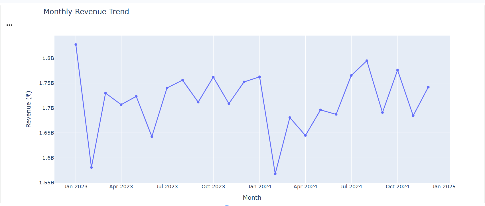

This visualization helps identify overall revenue stability, fluctuations, and potential seasonal patterns.

---

## 2. Product Category Performance

Revenue and units sold were analyzed across all major product categories.

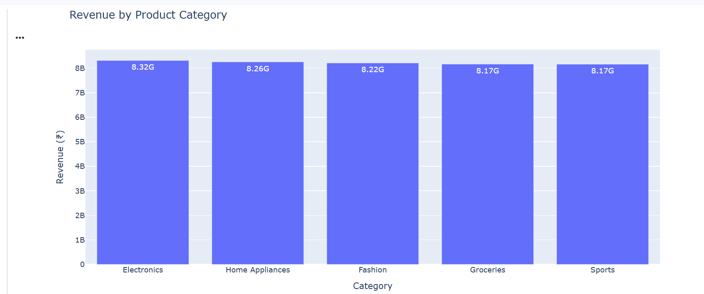

### Category Revenue

| Product Category | Revenue |
|---|---:|
| Electronics | ₹8.319 B |
| Home Appliances | ₹8.263 B |
| Fashion | ₹8.216 B |
| Groceries | ₹8.171 B |
| Sports | ₹8.166 B |

**Electronics** generated the highest total revenue among all product categories.

---

## 3. Store Performance Analysis

Store performance was evaluated using:

- Total Revenue
- Units Sold
- Average Rating
- Average Discount
- Number of Transactions

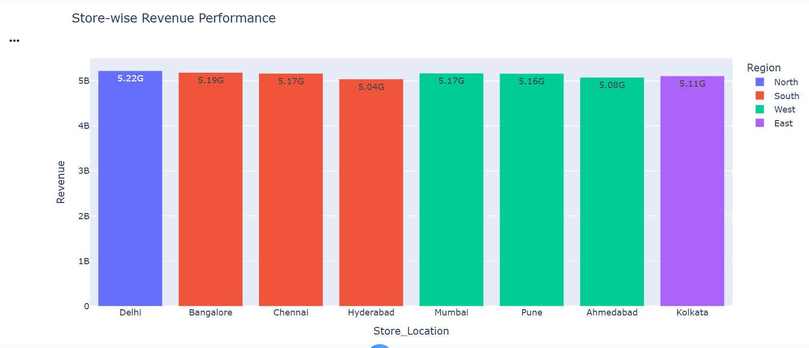

### Top Performing Store

**Delhi — STR_103**

Revenue generated:

**₹5.223 Billion**

This makes the Delhi store the highest-revenue store in the dataset.

---

## 4. Regional Revenue Analysis

Revenue was aggregated across geographic regions to identify the strongest-performing market.

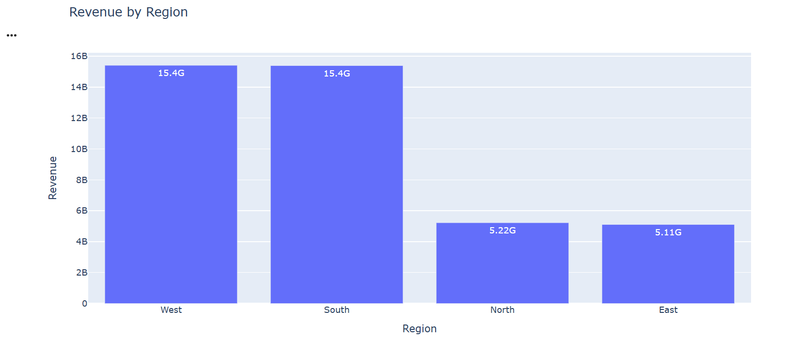

The analysis shows that the **West region generates the highest total revenue**.

---

## 5. Customer Type Analysis

Revenue contribution was analyzed across different customer types.

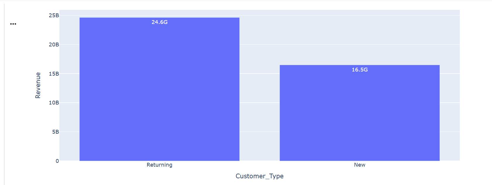

This helps understand which customer segments contribute most strongly to overall business revenue.

---

## 6. Payment Mode Analysis

Different payment methods were compared according to the revenue generated.

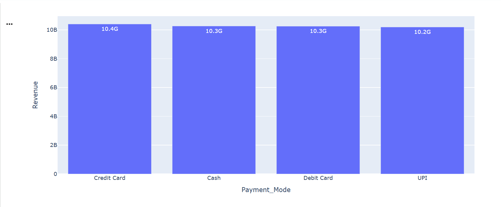

**Credit Card** transactions generated the highest revenue among the available payment modes.

---

## 7. Promotion Analysis

Promotional and non-promotional transactions were compared to understand whether promotions were associated with higher transaction revenue.

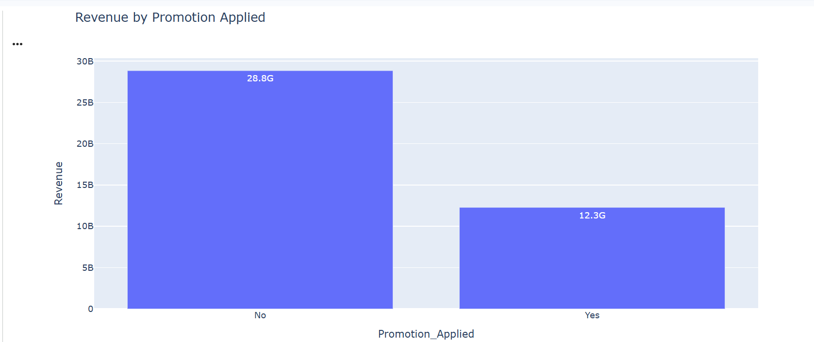

The average revenue difference for promotional transactions compared with non-promotional transactions was approximately:

**-0.29%**

This suggests that promotions did not produce a meaningful increase in average transaction revenue within this dataset.

---

## 8. Holiday Analysis

Sales performance was also compared between holiday and non-holiday transactions.

| Day Type | Total Revenue | Average Revenue | Units Sold |
|---|---:|---:|---:|
| Non-Holiday | ₹40.641 B | ₹563,650.82 | 1,795,915 |
| Holiday | ₹492.868 M | ₹549,462.78 | 21,390 |

The number of holiday observations is considerably smaller than non-holiday observations, so total revenue should be interpreted in the context of the number of records.

---

# 🔗 Correlation Analysis

A correlation matrix was generated to study relationships between important numerical variables including:

- Unit Price
- Units Sold
- Total Sales
- Discount Percentage
- Revenue
- Stock on Hand
- Store Rating
- Holiday Flag

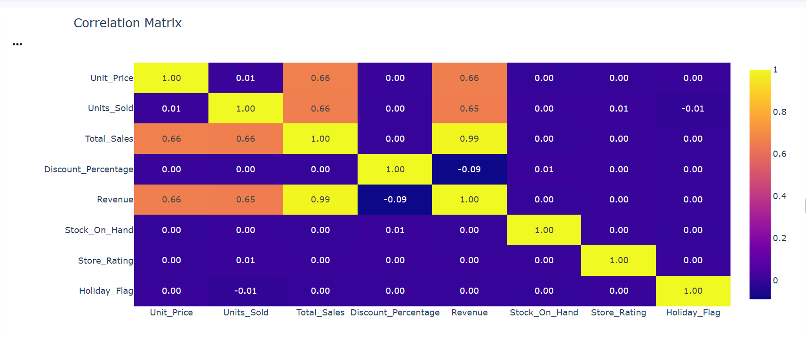

This analysis helps identify variables that move together and highlights relationships useful for further analytical modeling.

---

# 🔮 Revenue Forecasting

A time-series forecasting model was developed to estimate future daily revenue.

### Model

**Holt-Winters Exponential Smoothing**

The model uses:

- Additive trend
- Additive seasonality
- 7-day seasonal period

The final **60 days** of historical data were used as the test period for model evaluation.

---

## 📊 Forecast Model Evaluation

The forecasting model was evaluated by comparing predicted revenue against actual test-period revenue.

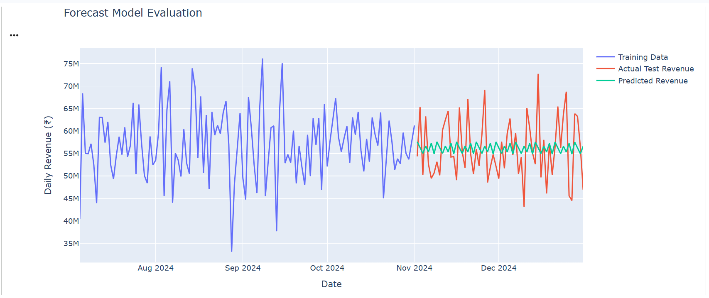

### Model Performance

| Metric | Result |
|---|---:|
| MAE | ₹5,582,397.32 |
| RMSE | ₹6,744,573.91 |
| MAPE | 10.01% |

A MAPE of approximately **10%** indicates that the model's predictions differ from actual daily revenue by roughly 10% on average.

---

# 📅 30-Day Revenue Forecast

After evaluation, the model was retrained using the complete daily revenue series and used to predict revenue for the next **30 days**.

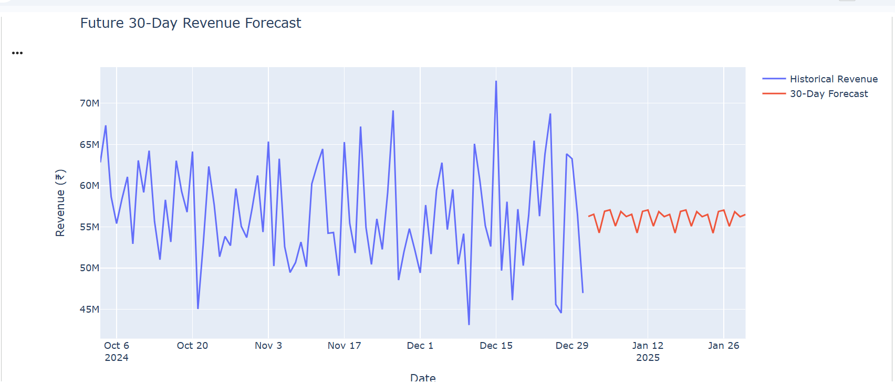

### Forecast Result

Expected total revenue for the next 30 days:

# ₹1.684 Billion

This forecast can support:

- Revenue planning
- Inventory management
- Resource allocation
- Sales target setting
- Short-term business planning

---

# 🤖 Store Segmentation Using Machine Learning

K-Means clustering was used to segment stores according to operational and financial performance.

### Features Used

- Total Revenue
- Total Units Sold
- Average Store Rating
- Average Discount
- Average Stock
- Number of Transactions

Before clustering, features were standardized using **StandardScaler**.

The stores were divided into **3 clusters**.

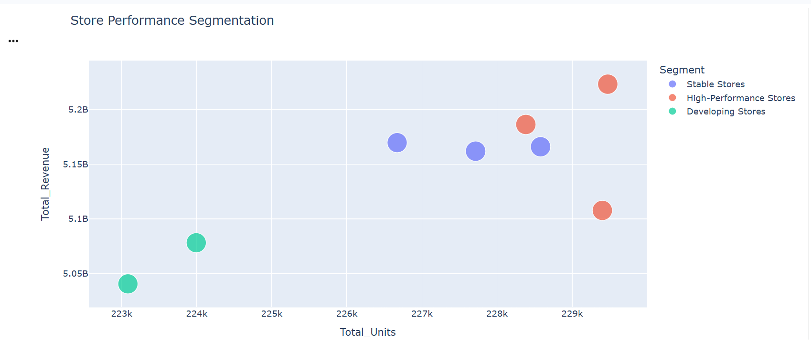

### Store Segments

| Segment | Stores |
|---|---|
| 🟢 High-Performance Stores | Delhi, Bangalore, Kolkata |
| 🟡 Stable Stores | Mumbai, Chennai, Pune |
| 🔴 Developing Stores | Ahmedabad, Hyderabad |

### Clustering Performance

**Silhouette Score: 0.36**

The segmentation provides management with a simple way to distinguish stores according to overall operational performance.

---

# 💡 Automated Business Insights

The analytical pipeline automatically generates management-level insights from the processed data.

### Key Findings

1. **Electronics** is the highest-revenue product category, generating approximately **₹8.319 billion**.

2. **Delhi (STR_103)** is the highest-performing store, generating approximately **₹5.223 billion** in revenue.

3. The **West region** generates the highest overall regional revenue.

4. **Credit Card** is the payment mode associated with the highest total revenue.

5. Promotional transactions show approximately **-0.29% difference in average revenue** compared with non-promotional transactions.

6. Revenue during the latest 30-day period increased by approximately **1.19%** compared with the previous 30-day period.

7. The forecasting model predicts approximately **₹1.684 billion** in revenue over the next 30 days.

8. Management can prioritize inventory and marketing for strong product categories while developing targeted improvement strategies for lower-performing stores.

---

# 💼 Business Applications

The system can assist retail management with:

### 📦 Inventory Planning
Forecasted sales and category performance can support better stock allocation.

### 🏪 Store Performance Management
Store segmentation allows management to identify high-performing and developing locations.

### 📣 Marketing Decisions
Promotion and customer analyses help evaluate the effectiveness of marketing activities.

### 💰 Revenue Planning
The 30-day forecasting system supports short-term financial planning.

### 🌍 Regional Strategy
Regional revenue analysis can help prioritize stronger geographic markets.

### 📊 Management Reporting
Automated KPIs and visualizations provide a concise overview of business performance.

---

# 📁 Repository Structure

All major project files are currently stored directly in the repository.

```text
Retail-Analytics-Sales-Forecasting/
│
├── README.md
├── Requirements.txt
│
├── BHAVYACHOPRAUNLOXMAJORPROJECT_ipynb.ipynb
├── 4877028-Retail_Sales_Data (1).xlsx
│
├── monthly_revenue_trend.png
├── category_performance.png
├── store_performance.png
├── regional_performance.png
├── customer_analysis.png
├── payment_mode_analysis.png
├── promotion_analysis.png
├── correlation_matrix.png
├── forecast_evaluation.png
├── revenue_forecast.png
└── store_segmentation.png
```

---

# ▶️ How to Run the Project

## 1. Clone the Repository

```bash
git clone https://github.com/bhavyachopra0309-wq/Retail-Analytics-Sales-Forecasting.git
```

Move into the project directory:

```bash
cd Retail-Analytics-Sales-Forecasting
```

---

## 2. Install Required Libraries

```bash
pip install -r Requirements.txt
```

The main libraries used are:

```text
numpy
pandas
matplotlib
plotly
scikit-learn
statsmodels
openpyxl
jupyter
```

---

## 3. Open the Notebook

Open:

```text
BHAVYACHOPRAUNLOXMAJORPROJECT_ipynb.ipynb
```

The notebook can be run using:

- Google Colab
- Jupyter Notebook
- JupyterLab

---

## 4. Load the Dataset

The dataset required for the analysis is already included in the repository:

```text
4877028-Retail_Sales_Data (1).xlsx
```

If running the notebook in Google Colab, upload the Excel file when prompted by the notebook.

---

# 📤 Project Outputs

The project generates several analytical outputs, including:

- Monthly revenue trends
- Product category performance
- Store-wise performance
- Regional analysis
- Customer analysis
- Payment mode analysis
- Promotion analysis
- Holiday analysis
- Correlation analysis
- Forecast model evaluation
- 30-day revenue forecast
- Store performance segmentation
- Automated business recommendations

The analytical pipeline can also export processed summaries and forecasting results as CSV/text files for further reporting.

---

# 🚀 Future Enhancements

Possible future improvements include:

- Developing an interactive Streamlit or Power BI dashboard
- Adding product-level demand forecasting
- Forecasting revenue separately for each store
- Adding anomaly detection for unusual sales activity
- Performing customer segmentation
- Comparing multiple forecasting algorithms
- Hyperparameter optimization
- Adding external variables such as economic indicators and weather
- Deploying the forecasting system as a web application
- Automating periodic model retraining and report generation

---

# ⭐ Project Highlights

- ✅ 73,000 retail transactions analyzed
- ✅ Complete data cleaning and feature engineering pipeline
- ✅ Business KPI analysis
- ✅ Interactive exploratory data analysis
- ✅ Product, store, region, customer and payment analysis
- ✅ Time-series revenue forecasting
- ✅ 30-day future revenue prediction
- ✅ K-Means machine learning segmentation
- ✅ Automated business insights
- ✅ Management-oriented recommendations
- ✅ Complete dataset included for reproducibility
- ✅ Visual results included directly in the GitHub repository

---

# 📌 Conclusion

This project demonstrates how raw retail transaction data can be transformed into a practical **data-driven decision-support system**.

By combining exploratory analytics, business KPIs, visualization, time-series forecasting, and machine-learning-based store segmentation, the system provides both an understanding of historical retail performance and insights that can support future planning.

The project demonstrates an end-to-end data analytics workflow — from raw data preprocessing to predictive modeling and management-level recommendations.

---

## 👩‍💻 Developed By

**Bhavya Chopra**


